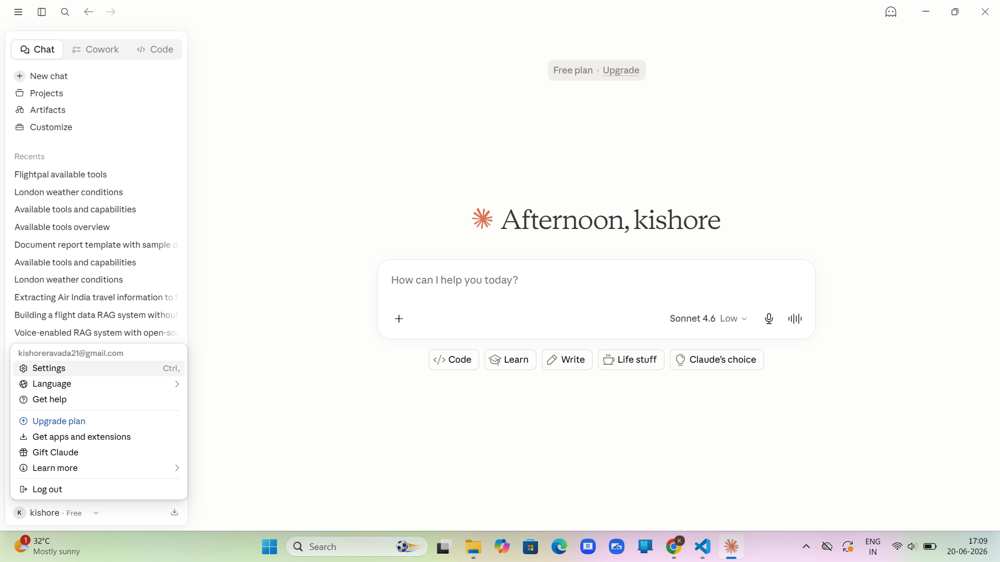
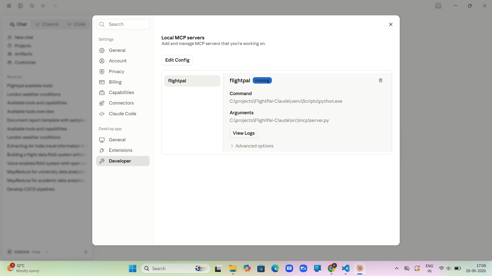
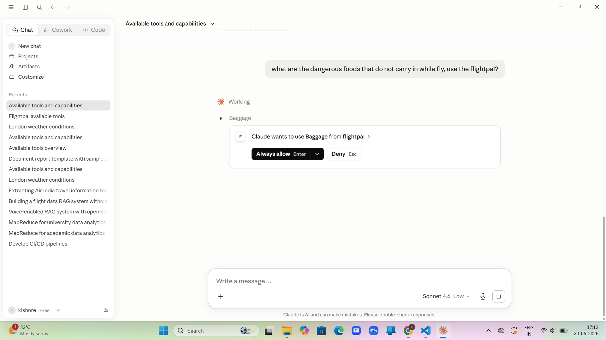
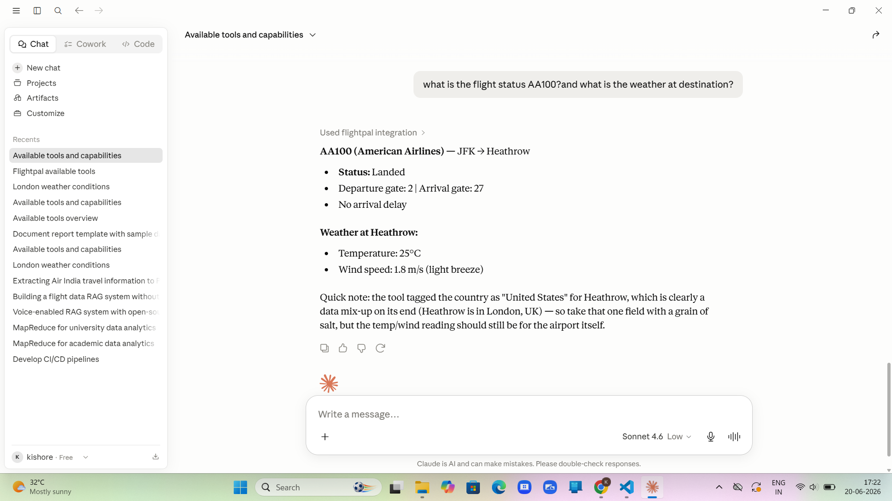
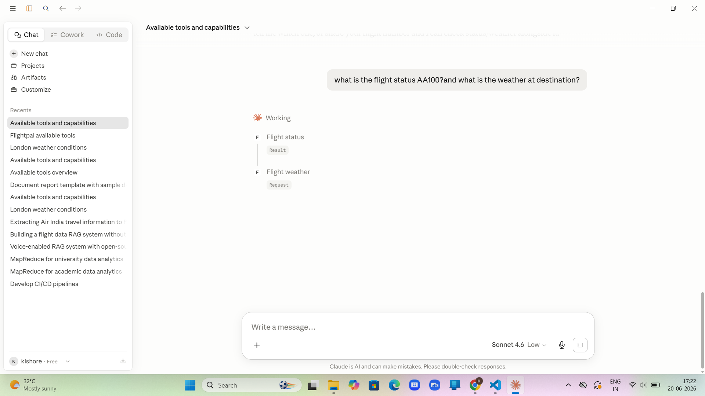
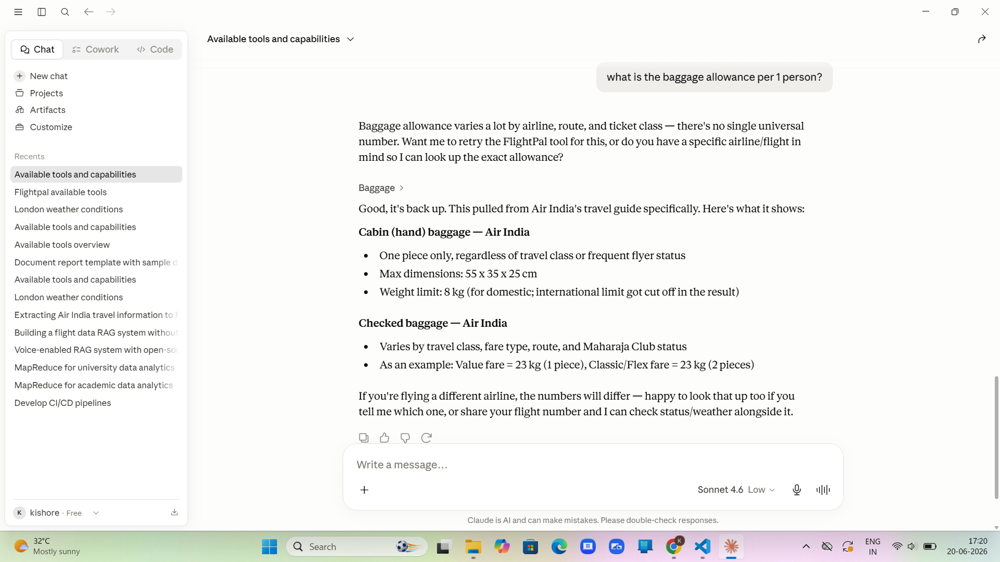
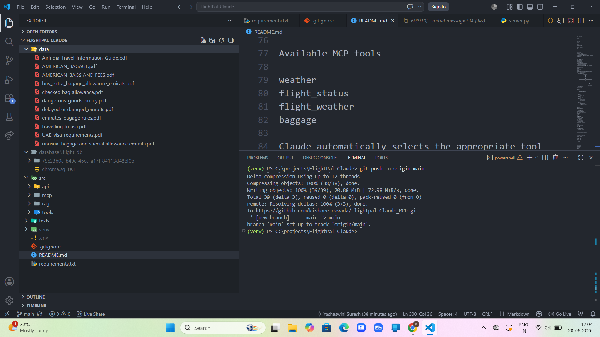

# ✈️ FlightPal — AI Travel Assistant

FlightPal is an AI-powered travel assistant built with **Python, LangChain, RAG, MCP (Model Context Protocol), and Claude Desktop**. It provides real-time flight information, weather updates, and airline policy assistance using live APIs and a local knowledge base.

---

## 🚀 Features

* ✈️ Live Flight Status
* 🌤 Live Weather
* 🌦 Flight + Destination Weather
* 📚 Airline Policy Search (RAG)
* 🤖 Claude Desktop MCP Integration

---

## 🛠 Tech Stack

* Python
* LangChain
* ChromaDB
* HuggingFace Embeddings
* Model Context Protocol (MCP)
* Anthropic Claude Desktop
* AviationStack API
* Open-Meteo API

---

## 🏗 Architecture

```text
Claude Desktop
       │
       ▼
 FlightPal MCP Server
       │
 ┌─────┼───────────────┐
 │     │               │
 ▼     ▼               ▼
Flight Weather      RAG Engine
 API     API            │
                         ▼
                  ChromaDB
                         │
                         ▼
                 Airline PDF Documents
```

---

## 📂 Project Structure

```text
FlightPal-Claude/
│
├── src/
│   ├── api/
│   ├── mcp/
│   ├── rag/
│   ├── tools/
│
├── data/
├── database/
├── tests/
├── requirements.txt
└── README.md
```

---

## ⚙️ Installation

```bash
git clone <repository-url>

cd FlightPal-Claude

python -m venv venv

venv\Scripts\activate

pip install -r requirements.txt
```

---

## 🔑 Configure Environment

Create a `.env` file.

```env
AVIATIONSTACK_API_KEY=YOUR_API_KEY
```

---

## 📚 Build the Vector Database

```bash
python -m src.rag.build_db
```

---

## 🧪 Run Tests

```bash
python -m tests.test_tools
```

---

## 🤖 Claude Desktop Setup

1. Open **Claude Desktop**
2. Go to **Settings → Developer**
3. Select **Edit Config**
4. Add the FlightPal MCP configuration.
5. Restart Claude Desktop.
6. Verify **FlightPal → Running** in Developer Settings.

Claude automatically discovers the following tools:

* weather
* flight_status
* flight_weather
* baggage

---

## 💬 Example Queries

* Check flight AA100
* What's the weather in London?
* Check AA100 and tell me the arrival weather.
* What baggage allowance does Emirates allow?
* Search Air India cabin baggage rules.

---

## 📄 Knowledge Base

The RAG system indexes airline documents including:

* Air India
* Emirates
* American Airlines
* UAE Visa Requirements
* Dangerous Goods Policies
* Baggage Rules
* Travel Guides

---

## 🔮 Future Improvements

* Airport Information
* Visa Checker
* Lounge Finder
* Security Wait Times
* Voice Assistant
* Streamlit / Gradio UI
* Multi-Agent Travel Planner

---

## 👨‍💻 Author

**Kishore Ravada**

GitHub: https://github.com/<your-username>

LinkedIn: https://linkedin.com/in/<your-profile>

---

## 📜 License

MIT License

## Screenshots

### Claude Desktop



---

### Claude Desktop settings



---
### Acaess to MCP



---

### Flight Status and weather



---

## Feaching tools



---

### Airline Policy RAG Search



---

### Project Architecture


